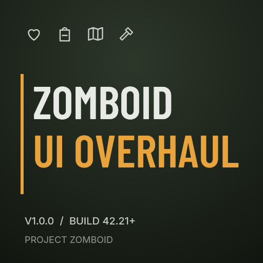
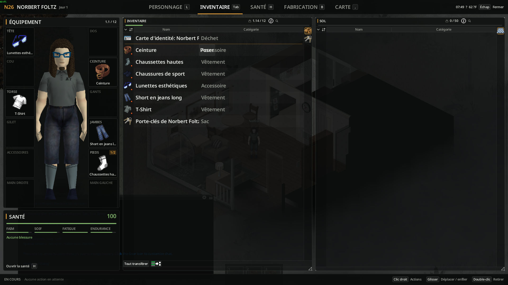
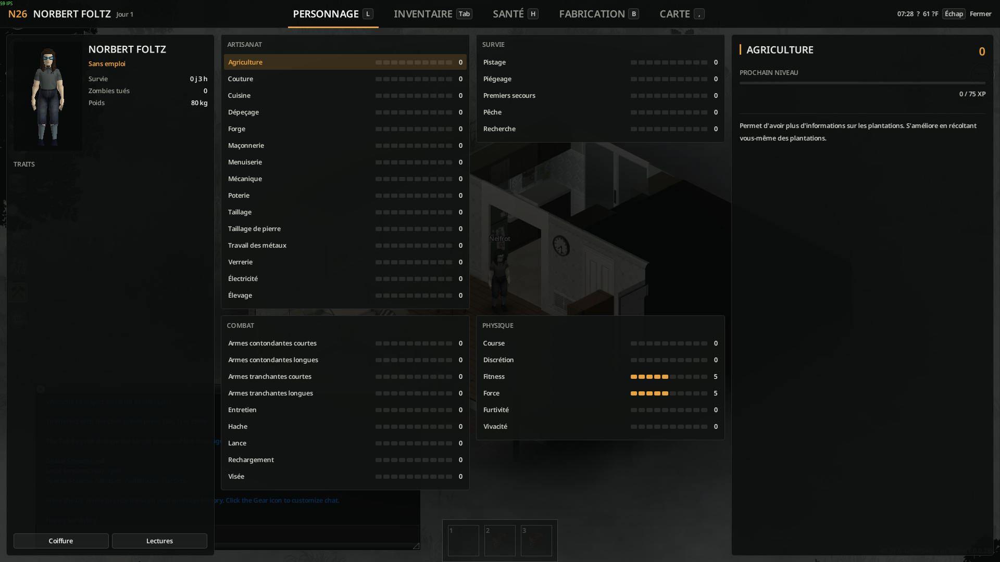
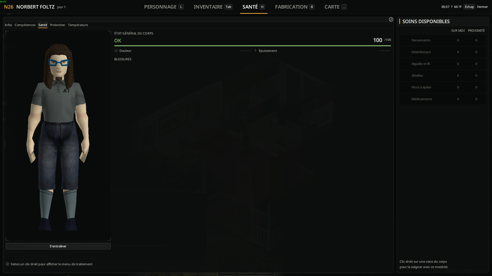
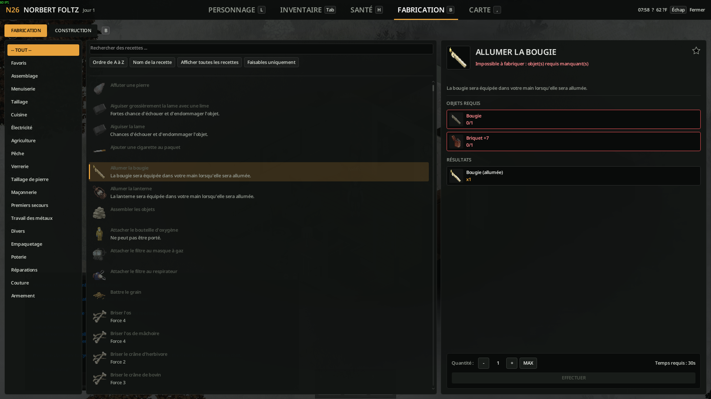
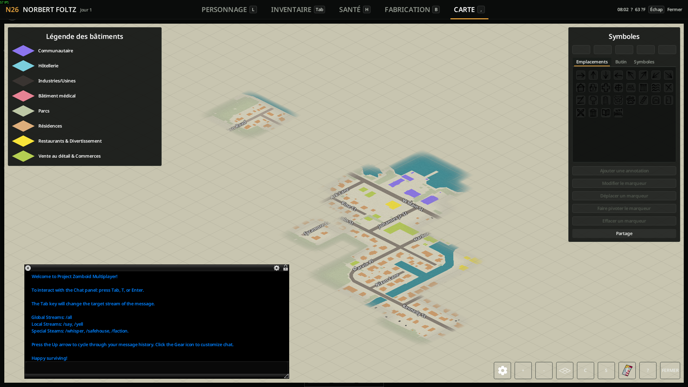

# Zomboid UI Overhaul

**V1.0.0 · Project Zomboid Build 42.21+ · Mouse & keyboard · English / Français**

[Subscribe on Steam Workshop](https://steamcommunity.com/sharedfiles/filedetails/?id=3824243701)

Your survivor, inventory, health, crafting and world map in one tactical screen.
Press **Tab** to open it. The world stays visible and keeps running, except when
the native world map pauses a solo game.

## Features

| Tab | What you get |
| --- | --- |
| Character | Identity, profession, traits, grouped skills, live levels, XP and reading bonuses. |
| Inventory | 3D survivor, 12 equipment slots, health summary, inventory and nearby loot side by side. |
| Health | Native treatment interactions and a list of medical supplies on you and nearby. |
| Crafting | Categories, search, favourites, craftable filter, requirements, quantities and construction mode. |
| Map | Native exploration, zoom, markers and map options inside the screen. |

Drag & drop, transfers, treatment and crafting retain the game's interactions.
The redesign applies to the tactical screen and the windows it hosts. No vanilla
texture, font or XUI style is replaced.

## Screenshots

### Inventory

### Character

### Health

### Crafting

### Map

## Installation

**Manual release ZIP:** extract its `N26_UIOverhaul` folder into your user
`Zomboid/mods` directory. The result must contain `N26_UIOverhaul/42/mod.info`
and `N26_UIOverhaul/common/`. Enable it in **Mods**, then restart the game.

**GitHub source ZIP:** rename its top folder `N26_UIOverhaul` if needed and place
it in the same directory. The prebuilt release ZIP is simpler for players.

**Steam Workshop:** [subscribe to Zomboid UI Overhaul](https://steamcommunity.com/sharedfiles/filedetails/?id=3824243701),
enable the mod and restart the game.

**Mod ID:** `N26_UIOverhaul`. In co-op/MP, the server must include it in its mod
list so clients retain it when joining. Broad multiplayer compatibility has not
been established.

## Controls and options

- **Tab:** open / close. The configured inventory key also works.
- **H / L / B / M:** Health / Character / Crafting / Map with default bindings.
- **Escape:** close. The shortcut of the current tab also closes it.
- **Equipment:** drag to wear/equip, right-click for actions, double-click to remove.
- **Options > Mods > Zomboid UI Overhaul:** modules, accent, opacity and animations.

## Compatibility and limitations

- Requires **Build 42.21 minimum**. Build 41 is unsupported.
- Controller players and the tutorial keep the native interface.
- Mods replacing the same inventory, health, character, crafting or map windows
  may conflict; compatibility with every UI mod is not claimed.
- Treatment uses the native body-part context menu. The care supplies column
  summarizes available items; it does not apply treatment automatically.
- Close the screen before quitting to avoid saving docked inventory sizes.

## Français

Un écran unique pour le personnage, l’inventaire, la santé, la fabrication et la
carte. Décompressez le ZIP de version dans `Zomboid/mods`, activez le mod puis
redémarrez le jeu. **Tab** ouvre et ferme l’écran. Réglages dans **Options > Mods**.
Build **42.21 minimum**, clavier et souris. Les transferts, soins et fabrications
utilisent les interactions du jeu. Les autres mods qui remplacent les mêmes
fenêtres peuvent entrer en conflit.

## Development

- [Development setup and checks](docs/DEVELOPMENT.md)
- [Changelog](CHANGELOG.md)

## License

Original project code and artwork: [MIT](LICENSE), copyright florentvandroy.
The source fonts have their own OFL licenses; see [third-party notices](THIRD_PARTY_NOTICES.md).
This is a community mod, unaffiliated with The Indie Stone. Game files are not redistributed.
